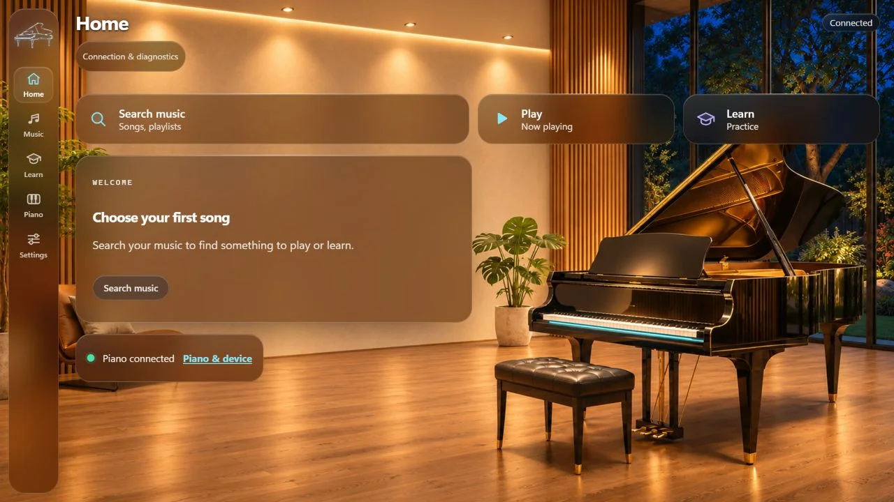

# PianoCore


**Your piano. A world to play.** A local piano studio running on your Raspberry Pi: USB-MIDI playback, a searchable library, guided practice and Crystal Stage note visualization.

[Website](https://www.redioncekrezi.de/app-sites/pianocore/en.html) · [Deutsch](README.md) · [Verification](EVIDENCE.md) · [Security](SECURITY.md) · [License](LICENSE)



The current interface uses studio photographs, clear glass, a crystal grand piano logo and cyan/lavender hand guidance. Day and Night share the same studio; Auto follows the device appearance. The screenshot is from the real app running locally with synthetic demonstration MIDI, without physical piano hardware.

## Connect and install

Connect your USB-MIDI piano to a Raspberry Pi running PianoCore. Open the Pi’s address from your phone, tablet or computer on the same trusted network. The website presents music, guided practice and Crystal Stage through silent illustrations using the app’s own renderer.

For installation, open the **app at the Pi’s HTTPS address** and choose the browser’s Install app command when available. Safari on iPhone/iPad uses Share → Add to Home Screen. The installed client still connects to your Pi, which must remain reachable. Opening the presentation website does not install the piano engine.

The manifest has stable identity, scope, 192/512 px and maskable crystal icons. A real browser installation event controls the in-app button. No service worker, offline API cache or automatic installation is added. HTTPS provisioning and deployment to the owner’s appliance remain separate release steps; physical acceptance is not claimed.

## What is implemented

- MIDI library search, playlists, recent music and playback control.
- Guided practice that waits for the right notes, lesson progress and section practice.
- Sheet music, falling notes, hybrid view and the Crystal Stage keyboard on the Core’s musical timeline.
- Live keyboard/pedal feedback and optional ESP32 LED guidance.
- One local musical authority with phone, tablet and desktop clients.

3D hands remain experimental. The lesson catalog is imported separately and is not bundled here. This is an MVP, not a commercially accepted appliance.

## Local development

```bash
git clone https://github.com/IamRedi/pianocore && cd pianocore
python3 -m venv .venv && . .venv/bin/activate
pip install -e .  # Linux: python-rtmidi requires libasound2-dev
python tools/demo_local.py
```

Open `http://127.0.0.1:8788/ui/`. The disposable local demo uses the real Application with silent synthetic MIDI boundaries and four public-domain melodies. It does not connect to your appliance. The native presentation is at `/ui/about/en.html` (also SQ/DE/IT).

```bash
PYTHONPATH=src:tests python -m unittest discover -s tests -t .
npm install --no-save --no-package-lock ws@8.18.0
node --test tests/weblogic/*.test.mjs
```

Routine verification runs locally. GitHub Actions is manual only; no cloud run was requested for this update. Historical checks and current limits are recorded in [EVIDENCE.md](EVIDENCE.md).

## Architecture and rights

Python 3.11+, SQLite, mido/python-rtmidi, same-origin HTTP/SSE and browser-native HTML/CSS/JavaScript. The Pi owns musical truth; views do not advance practice independently. The unauthenticated control API is intended for trusted networks only; never expose it to the public internet. See [SECURITY.md](SECURITY.md).

This public source mirror excludes private task records, device logs, personal paths and the appliance address. Crystal identity and studio assets belong to Redion Cekrezi; Three.js and Manrope retain their bundled licenses. Experimental 3D-hand commercial licensing remains unverified. See [LICENSE](LICENSE) and [EVIDENCE.md](EVIDENCE.md).
