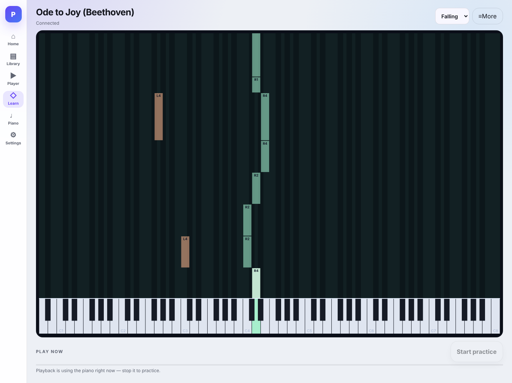
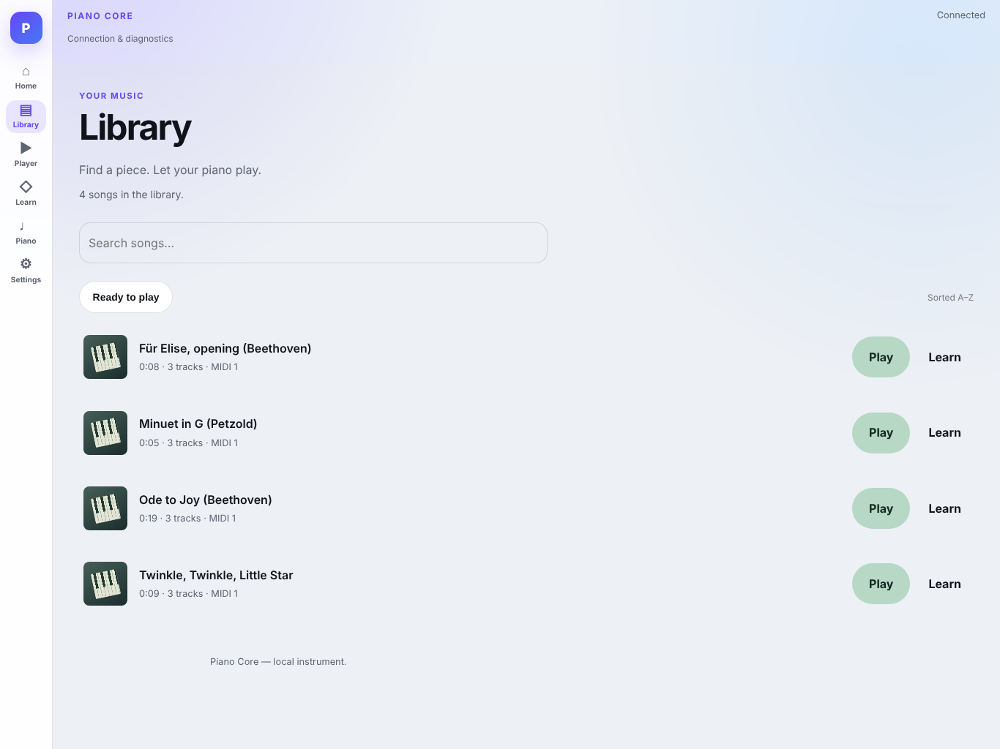
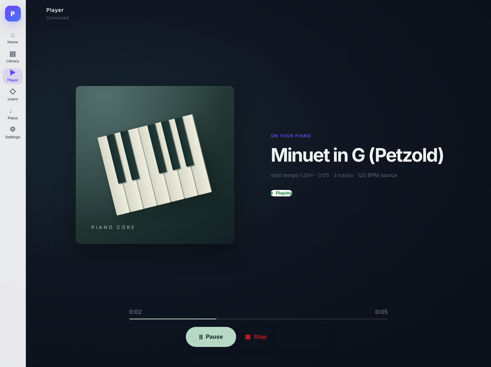
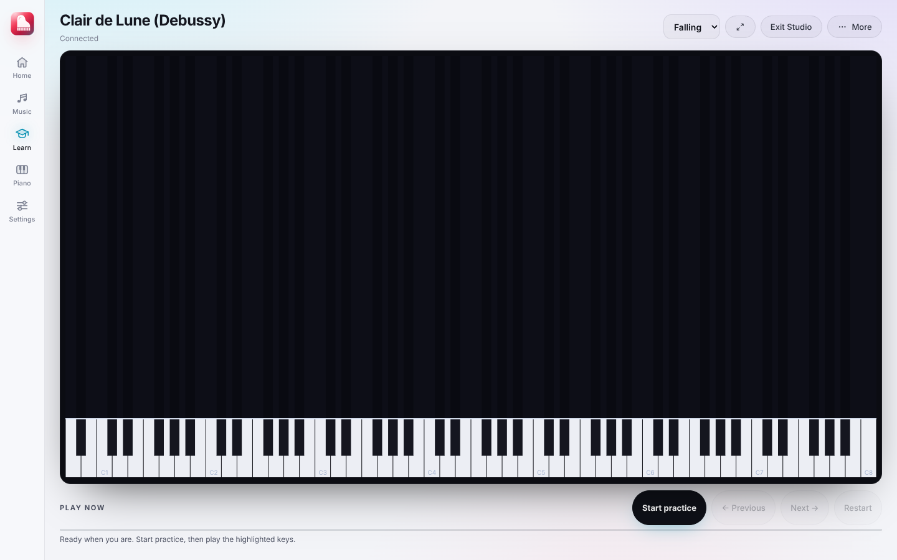
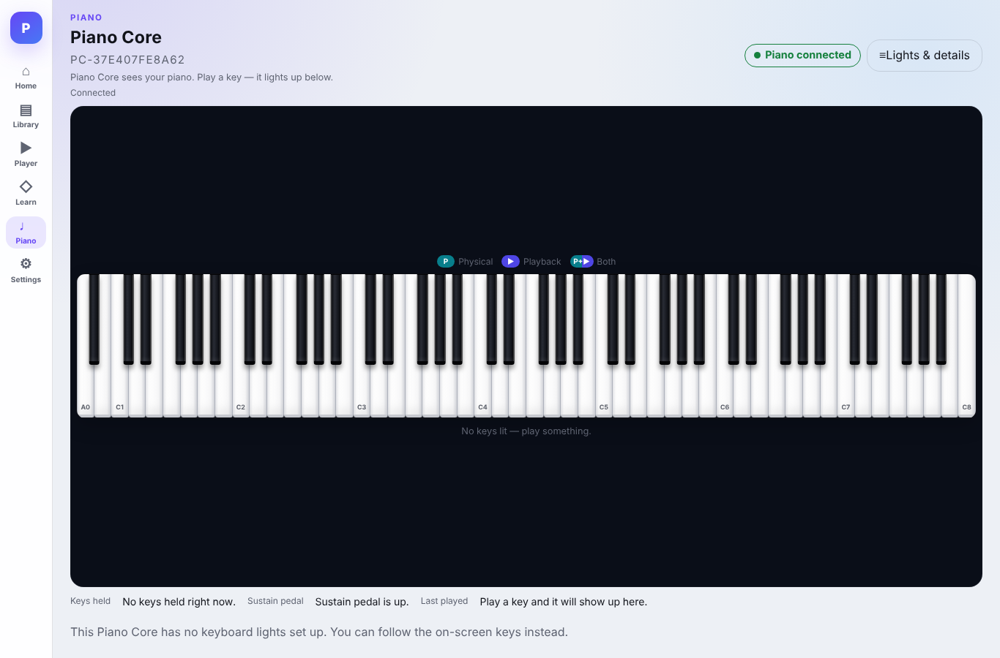

# Piano Core

[](https://github.com/IamRedi/pianocore/actions/workflows/ci.yml)

**A Raspberry Pi that turns a digital piano into an instrument that teaches.** Piano Core runs next to the piano, talks to it over USB-MIDI, plays pieces on it, listens while you practise and shows on a tablet which key and which finger come next. No cloud, no account, no internet needed.

[Deutsche Version](README.md) · [Project status (DE)](docs/PROJEKTSTAND.md) · [Verification record](EVIDENCE.md) · [Security](SECURITY.md)



## At a glance

| | |
|---|---|
| **What** | Device software for a digital piano: player, library, learning mode with fingering, live keyboard, optional LED strip above the keys |
| **Hardware** | Raspberry Pi 4, Roland digital piano over USB-MIDI (both directions), optional ESP32 driving a WS2812 LED strip (196 LEDs for 88 keys) |
| **Interface** | Web UI on the home network, designed for a tablet, also works on phone and desktop |
| **Stack** | Python 3.11+ (standard library plus `mido`/`python-rtmidi`), SQLite, HTTP API with Server-Sent Events, plain JavaScript UI with no build step, Three.js for the 3D hands |
| **Tests** | 1,240 Python tests and 535 UI-logic checks, all passing ([verification record](EVIDENCE.md)) |
| **Status** | Runs on the author's own Raspberry Pi and piano. Not a commercial product. |

## What it does

- **Player.** Plays MIDI files from your library on the real piano, with pause, stop and tempo.
- **Learn.** 1,557 lessons in 80 courses from the open Pianio curriculum (CC0). Modes: wait for the right key, play along in time, right or left hand alone, loop a section, slow practice. Progress is stored per lesson.
- **Fingering and hands.** A fingering is computed for every piece (R1–R5, L1–L5) and shown as falling notes or with animated 3D hands.
- **Live keyboard.** Every key and the pedal show up on screen immediately, split into "played by you" and "played by the player".
- **LED strip.** With an ESP32 and LED strip attached, the next keys light up right above the keyboard.
- **One device, many screens.** The Pi owns the single source of truth. Tablet, phone or, later, Home Assistant are only API clients.

| Library | Player | Learning academy | Live keyboard |
|---|---|---|---|
|  |  |  |  |

The screenshots come from the local demo below (silent placeholder MIDI instead of a real piano), not from the device.

## Try it without a piano

```bash
git clone https://github.com/IamRedi/pianocore && cd pianocore
python3 -m venv .venv && . .venv/bin/activate
pip install -e .            # on Linux, python-rtmidi needs libasound2-dev

# player + library with four public-domain melodies
python tools/demo_local.py

# plus the learning catalog from the open Pianio curriculum
git clone --depth 1 https://github.com/ismaelponce/pianio /tmp/pianio
python tools/demo_local.py --pianio /tmp/pianio
```

Then open `http://127.0.0.1:8788/ui/`. The demo starts the real application; only the piano input and output are silent placeholders. Everything lives in a temporary folder that is removed on exit.

## Tests

```bash
PYTHONPATH=src:tests python -m unittest discover -s tests -t .
npm install --no-save ws@8      # only for release_harness.test.mjs
for f in tests/weblogic/*.test.mjs; do node "$f" || exit 1; done
```

The tests need no hardware: MIDI devices, the LED controller and the clock are replaced by controlled test doubles. Run as root, some tests fail because they check file permissions. GitHub Actions runs both suites and a secret scan on every push.

## Layout

```
src/piano_core/
  app.py            composition of all subsystems, startup and orderly shutdown
  midi/             USB-MIDI input and output, reconnect, safety stop
  playback/         timeline and playing MIDI on the piano
  library/          reading and indexing the MIDI library (read-only)
  learn/            building the learning catalog from open sources
  packages/         practice packages: import, validation, progress
  practice/         practice modes and grading
  fingering/        fingering engine
  led/              protocol to the LED strip (ESP32)
  api/              HTTP API and Server-Sent Events
  web/static/       UI (HTML, CSS, JavaScript, Three.js)
ops/                systemd units and deploy helper for the Raspberry Pi
docs/               architecture decisions (ADRs), operations docs, baseline spec
tools/              local demo, 3D hand build tool
```

Key decisions are in [`docs/decisions/`](docs/decisions/), running it on the Pi in [`docs/operations/`](docs/operations/).

## Origin

Piano Core is a personal project by Redion Cekrezi, built together with AI coding agents under a working standard of the author's own: every task has acceptance criteria, an independent review and a written record before anything reaches the device. This public repository is a cleaned snapshot of the private development repository (as of 14 October 2026), without history, internal evidence folders or home-network data. What was removed is listed in the [verification record](EVIDENCE.md).

## License

Source-available, not open source: see [LICENSE](LICENSE). Third-party components (Three.js, MIT) keep their own licenses.
