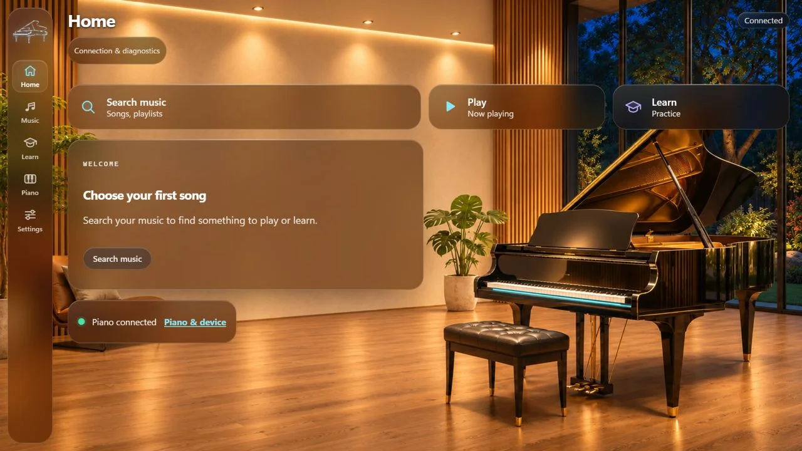

# PianoCore


**Sieh die Musik. Spüre jede Note.** PianoCore verbindet MIDI-Player, Musikbibliothek, geführtes Üben, Tastatur-LEDs, Crystal Stage und Smart-Home-Steuerung mit deinem Digitalpiano.

[Website](https://www.redioncekrezi.de/app-sites/pianocore/de.html) · [English](README.en.md) · [Technische Dokumentation](EVIDENCE.md) · [Sicherheit](SECURITY.md) · [Lizenz](LICENSE)



## Ein vollständiges Klavierstudio

- **MIDI-Player.** Wähle ein Stück und höre es auf deinem Digitalpiano. Start, Pause, Stopp, Tempo und das nächste Stück steuerst du direkt.
- **MIDI-Bibliothek.** Durchsuche deine Titelliste, finde Stücke, organisiere Playlists und kehre zur zuletzt gehörten Musik zurück.
- **Tastatur-LEDs.** Lichter über den Tasten folgen der Musik und zeigen die nächsten Übungsziele.
- **Geführtes Üben.** Auf die richtigen Noten warten, eine Hand einzeln üben, Passagen wiederholen, Tempo reduzieren und Lernfortschritt verfolgen.
- **Crystal Stage.** Fallende Noten, Kristalltastatur, Links-/Rechts-Farbführung und Fingersatz im Lernmodus. Notenblatt, fallende Noten oder Hybridansicht wählen.
- **Smart Home.** Steuere das Klavier über seine Befehlsschnittstelle und binde es in Szenen und Automationen ein.
- **Deine Bildschirme.** Handy, Tablet oder Computer. Tag, Nacht und Auto verbinden denselben Studioraum mit dem Kristallflügel-Logo und klaren Glasflächen.

## Lokale Architektur

PianoCore läuft auf Raspberry Pi und verbindet das Digitalpiano über USB-MIDI. Python, SQLite und mido/python-rtmidi bilden die musikalische Laufzeit; der Browser nutzt die gleichnamige HTTP/SSE-Schnittstelle. Der Pi verwaltet den musikalischen Zustand, die Anzeigen folgen ihm.

Der Webclient enthält ein Installationsmanifest und Kristall-App-Icons. Öffne die HTTPS-Adresse deines Geräts für die Browser-Installation; Safari bietet Teilen → Zum Home-Bildschirm. Die native Produktwebsite liegt unter `/ui/about/` in SQ/EN/DE/IT.

## Entwicklung

```bash
git clone https://github.com/IamRedi/pianocore && cd pianocore
python3 -m venv .venv && . .venv/bin/activate
pip install -e .  # Linux-Build-Abhängigkeit: libasound2-dev
python tools/demo_local.py
```

Öffne `http://127.0.0.1:8788/ui/`. Der lokale Entwicklungsplayer enthält vier gemeinfreie Melodien und stille MIDI-Adapter. Der Lernkatalog kann separat importiert werden.

```bash
PYTHONPATH=src:tests python -m unittest discover -s tests -t .
npm install --no-save --no-package-lock ws@8.18.0
node --test tests/weblogic/*.test.mjs
python tools/sync_presentation_assets.py --check
```

Entwicklungsprüfungen laufen lokal; GitHub Actions kann manuell gestartet werden. [EVIDENCE.md](EVIDENCE.md) enthält die technische Historie und Prüfergebnisse.

Code, Produktgrafiken und Studio-Assets: Redion Cekrezi. Three.js und Manrope behalten ihre beigefügten Lizenzen. Siehe [LICENSE](LICENSE) und [SECURITY.md](SECURITY.md).
